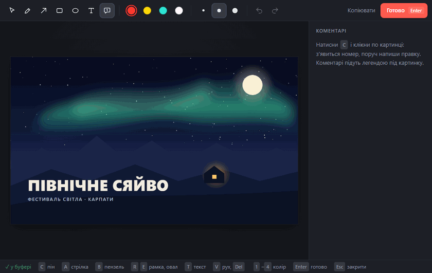
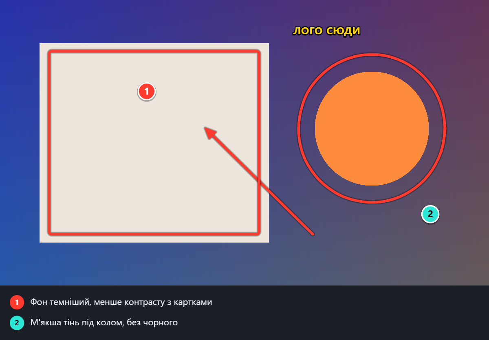

<p align="center"></p>

<h1 align="center">ArtNote</h1>

<p align="center">Швидкі правки для артдирекшену: виділив шматок екрана → намалював стрілку, поставив номер, написав коментар → <b>Ctrl+V</b> у чат.</p>

<p align="center"></p>

Маленька програма в треї для Windows, macOS і Linux. Заточена під одну дію: показати, що саме треба змінити на картинці, і віддати це одним вставленням у чат (Claude, Slack, Telegram — куди завгодно). Коментарі-піни підшиваються легендою під картинку, тож текст і зображення не роз'їжджаються.

## Як це працює

1. **Win + Alt + A** — екран замерзає, тягнеш рамку по потрібній ділянці (Enter — весь екран, Esc — скасувати).
2. Одразу відкривається редактор. Чистий скрін уже лежить у буфері обміну.
3. Малюєш і пишеш. Буфер оновлюється сам після кожної зміни — внизу блимає «✓ у буфері». Кнопку «Копіювати» натискати не треба.
4. **Enter** — зберегти правку в папку й закрити. Або просто перемкнутися в чат і вставити.

Що потрапляє в буфер і в папку:

<p align="center"></p>

## Інструменти

| Клавіша | Що робить |
|---|---|
| <kbd>C</kbd> | Пін-коментар: номер на картинці + текст у легенді |
| <kbd>A</kbd> | Стрілка (<kbd>Shift</kbd> — кроком 45°) |
| <kbd>B</kbd> | Пензель |
| <kbd>R</kbd> / <kbd>E</kbd> | Рамка / овал (<kbd>Shift</kbd> — квадрат / коло) |
| <kbd>T</kbd> | Текст прямо на картинці |
| <kbd>V</kbd> | Вибрати й перетягнути; <kbd>Del</kbd> — видалити; подвійний клік — редагувати текст |
| <kbd>1</kbd>–<kbd>4</kbd> | Колір: червоний, жовтий, бірюзовий, білий |
| <kbd>[</kbd> <kbd>]</kbd> | Товщина |
| <kbd>Ctrl+Z</kbd> / <kbd>Ctrl+Y</kbd> | Скасувати / повторити |
| <kbd>Enter</kbd> | Готово: зберегти, скопіювати, закрити |
| <kbd>Esc</kbd> ×2 | Закрити без збереження |

Клавіші працюють і на українській розкладці. Коментарі пінів можна правити в бічній панелі; останні вибрані інструмент, колір і товщина запам'ятовуються.

## Що зберігається

Кожна правка — три файли в папці `notesDir` (за замовчуванням `Documents\ART_NOTES`):

```
2026-10-31_11-47-28.png      картинка з розміткою і легендою
2026-10-31_11-47-28_src.png  чистий оригінал
2026-10-31_11-47-28.md       коментарі списком, з координатами пінів у пікселях
```

`.md` зручно віддавати AI-асистенту з доступом до файлів: «дивись останню правку» — і він читає текст і картинку разом.

## Встановлення

Завантаж файл для своєї системи з [останнього релізу](../../releases/latest):

| Система | Файл | Як встановити |
|---|---|---|
| **Windows** 10/11 | `ArtNote-Setup-<версія>.exe` | Двічі клікни — встановиться за кілька секунд і запуститься. Права адміністратора не потрібні, видалення — через «Програми». |
| **macOS** Apple Silicon | `ArtNote-<версія>-arm64.dmg` | Відкрий і перетягни ArtNote в Applications. |
| **macOS** Intel | `ArtNote-<версія>-x64.dmg` | Те саме. |
| **Linux** | `ArtNote-<версія>-x86_64.AppImage` | `chmod +x ArtNote-*.AppImage` і запусти. |
| **Linux** Debian / Ubuntu | `ArtNote-<версія>-amd64.deb` | `sudo apt install ./ArtNote-*.deb` |

Програма поки не підписана платним сертифікатом, тому система може перепитати:

- **Windows** показує «Windows захистив ваш ПК» → «Докладніше» → «Усе одно запустити».
- **macOS** при першому запуску: правий клік по ArtNote в Applications → «Відкрити» (на macOS 15+: System Settings → Privacy & Security → «Open Anyway»). На першій правці macOS попросить дозвіл на **запис екрана** — дай його й перезапусти ArtNote. Хоткей на Mac — <kbd>Cmd+Option+A</kbd>.
- **Linux**: найкраще працює в сесії X11. У Wayland глобальний хоткей може не спрацювати — тоді починай правку з меню іконки в треї (у GNOME для іконок у треї потрібне розширення AppIndicator).

Після запуску ArtNote живе в треї (на Mac — у рядку меню). Лівий клік по іконці — нова правка, правий — меню:

- **Нова правка** — те саме, що хоткей
- **Правка з буфера обміну** — відкрити в редакторі картинку, яку вже скопіював
- **Відкрити папку з правками** / **Змінити папку для правок…**
- **Файл налаштувань (хоткей)**
- **Запускати разом із системою**
- **Підтримати автора ♥**

## Налаштування

Пункт меню «Файл налаштувань» відкриває `config.json` (він лежить у `%APPDATA%\ArtNote` на Windows, `~/Library/Application Support/ArtNote` на Mac, `~/.config/ArtNote` на Linux):

```json
{
  "hotkey": "Super+Alt+A",
  "fallbackHotkey": "Shift+PrintScreen",
  "notesDir": "D:\\Notes\\ART_NOTES"
}
```

Хоткей записується у форматі [Electron accelerator](https://www.electronjs.org/docs/latest/api/accelerator) (`Super` — це Win на Windows і Cmd на Mac). Якщо основний зайнятий іншою програмою, ArtNote бере запасний. Після зміни перезапусти програму. Там само лежить `artnote.log` — перше місце, куди дивитися, якщо щось не так.

## Підтримати

ArtNote безкоштовний і з відкритим кодом. Якщо він економить тобі час на правках — підтримати автора можна з меню в треї («Підтримати автора ♥») або тут:

| Монета | Мережа | Адреса |
|---|---|---|
| USDT | лише Tron (TRC20) | `TLzNJFQUgD7AqqdCggQdm7ogX4UPHrmZqV` |
| BTC | лише Bitcoin | `115jhb9iiWF99C5uaC6N27T4QVLmkmY2E8` |
| USDC | лише BNB Smart Chain (BEP20) | `0x87d6a63b18b351d34211cc4b04e28494c1eb963a` |
| SOL | лише Solana | `E2duNyxT8zmqEUwFuupoi8xJHBH4bt1axStYKrhS3M4x` |
| ADA | лише Cardano | `addr1vylp2e0g50p029ar76rvtavwq0wrazh63a60uazju482k2gz96gpm` |

Надсилай кожну монету тільки в зазначеній мережі: переказ через іншу мережу загубиться. QR-коди для телефонного гаманця є у вікні «Підтримати автора ♥» у меню програми.

## Запуск із коду

Потрібен [Node.js](https://nodejs.org) 20+.

```bash
git clone https://github.com/artsocity23-ux/artnote.git
cd artnote
npm install
npm start
```

На Windows `npm install` заодно збирає `grab.exe` — крихітний помічник для швидкого знімка екрана (компілятор C# є в кожній Windows з .NET Framework 4, нічого ставити не треба). Без нього ArtNote теж працює, просто екран захоплюється повільніше. Запущений із коду ArtNote тримає `config.json` і лог поруч із кодом (є `config.example.json`).

`npm run dist` збирає інсталятор для поточної системи в `dist/`. Інсталятори для всіх трьох систем збирає GitHub Actions (`.github/workflows/build.yml`): тег `v*` публікує їх у реліз.

## Як влаштовано

- **Electron** — трей, редактор (Canvas 2D), вікна вибору області.
- **grab.exe** (`grab.cs`, лише Windows) живе у фоні й на кожен запит віддає сирий BGRA-знімок усього віртуального екрана через GDI: ~0,2 с проти ~1 с у `desktopCapturer`. Вікна вибору області створені заздалегідь, тому від хоткея до замерзлого екрана ~0,3 с. На macOS і Linux екран знімає `desktopCapturer`.
- Розмітка зберігається як вектор у пікселях оригіналу, тож експорт завжди в повній роздільності, незалежно від масштабу вікна.
- `artnote.log` — хоткей, час захоплення, збереження.

| Файл | |
|---|---|
| `main.js` | трей, хоткей, захоплення екрана, збереження |
| `overlay.html` / `overlay.js` | замерзлий екран і вибір області |
| `editor.html` / `editor.js` / `editor.css` | редактор |
| `clip.js` | буфер обміну (асинхронний API Electron 45) |
| `donate.html` / `donate.js` / `donate.json` | вікно «Підтримати»; порожні пункти в `donate.json` не показуються |
| `grab.cs`, `build/grab.js` | швидкий знімок екрана для Windows і його збірка |
| `selftest.js` | наскрізний тест без людини |
| `demo.js` / `demo.html` | запис анімації для цього README: `npm run demo` → `docs/demo.gif` |
| `make-icon.js` | генерує іконки, зокрема `build/icon.png` для інсталяторів |

## Самоперевірка

```bash
npm run selftest
```

Відкриває редактор на згенерованій картинці, малює справжніми подіями миші й клавіатури, перевіряє буфер і збережені файли, потім проходить вибір області. Результат — `selftest-out/report.json` і скріншоти. Твій буфер обміну після тесту відновлюється.

## Ліцензія

[MIT](LICENSE)
