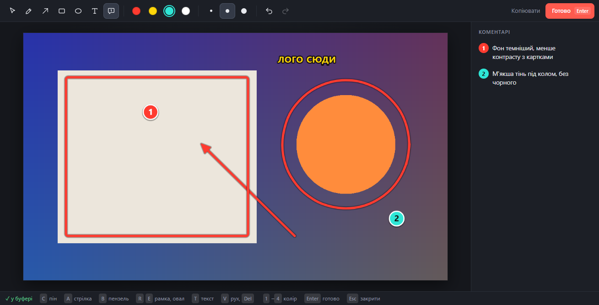

<p align="center"></p>

<h1 align="center">ArtNote</h1>

<p align="center">Швидкі правки для артдирекшену: виділив шматок екрана → намалював стрілку, поставив номер, написав коментар → <b>Ctrl+V</b> у чат.</p>

<p align="center"></p>

Маленька програма в треї Windows. Заточена під одну дію: показати, що саме треба змінити на картинці, і віддати це одним вставленням у чат (Claude, Slack, Telegram — куди завгодно). Коментарі-піни підшиваються легендою під картинку, тож текст і зображення не роз'їжджаються.

## Як це працює

1. **Win + Alt + A** — екран замерзає, тягнеш рамку по потрібній ділянці (Enter — весь екран, Esc — скасувати).
2. Одразу відкривається редактор. Чистий скрін уже лежить у буфері обміну.
3. Малюєш і пишеш. Буфер оновлюється сам після кожної зміни — внизу блимає «✓ у буфері». Кнопку «Копіювати» натискати не треба.
4. **Enter** — зберегти правку в папку й закрити. Або просто перемкнутися в чат і вставити.

Що потрапляє в буфер і в папку:

<p align="center"></p>

## Інструменти

| Клавіша | Що робить |
|---|---|
| <kbd>C</kbd> | Пін-коментар: номер на картинці + текст у легенді |
| <kbd>A</kbd> | Стрілка (<kbd>Shift</kbd> — кроком 45°) |
| <kbd>B</kbd> | Пензель |
| <kbd>R</kbd> / <kbd>E</kbd> | Рамка / овал (<kbd>Shift</kbd> — квадрат / коло) |
| <kbd>T</kbd> | Текст прямо на картинці |
| <kbd>V</kbd> | Вибрати й перетягнути; <kbd>Del</kbd> — видалити; подвійний клік — редагувати текст |
| <kbd>1</kbd>–<kbd>4</kbd> | Колір: червоний, жовтий, бірюзовий, білий |
| <kbd>[</kbd> <kbd>]</kbd> | Товщина |
| <kbd>Ctrl+Z</kbd> / <kbd>Ctrl+Y</kbd> | Скасувати / повторити |
| <kbd>Enter</kbd> | Готово: зберегти, скопіювати, закрити |
| <kbd>Esc</kbd> ×2 | Закрити без збереження |

Клавіші працюють і на українській розкладці. Коментарі пінів можна правити в бічній панелі; останні вибрані інструмент, колір і товщина запам'ятовуються.

## Що зберігається

Кожна правка — три файли в папці `notesDir` (за замовчуванням `Documents\ART_NOTES`):

```
2026-10-31_11-47-28.png      картинка з розміткою і легендою
2026-10-31_11-47-28_src.png  чистий оригінал
2026-10-31_11-47-28.md       коментарі списком, з координатами пінів у пікселях
```

`.md` зручно віддавати AI-асистенту з доступом до файлів: «дивись останню правку» — і він читає текст і картинку разом.

## Встановлення

Потрібні Windows 10/11 і [Node.js](https://nodejs.org) 18+.

```bash
git clone https://github.com/artsocity23-ux/artnote.git
cd artnote
npm install
npm start
```

`npm install` заодно збирає `grab.exe` — крихітний помічник для швидкого знімка екрана (компілятор C# є в кожній Windows з .NET Framework 4, нічого ставити не треба). Без нього ArtNote теж працює, просто екран захоплюється повільніше.

Після запуску іконка з'являється в треї. Правий клік по ній:

- **Нова правка** — те саме, що хоткей
- **Правка з буфера обміну** — відкрити в редакторі картинку, яку вже скопіював
- **Відкрити папку з правками**
- **Запускати разом з Windows**

Лівий клік по іконці теж починає нову правку.

## Налаштування

Скопіюй `config.example.json` у `config.json` і зміни, що треба:

```json
{
  "hotkey": "Super+Alt+A",
  "fallbackHotkey": "Shift+PrintScreen",
  "notesDir": "D:\\Notes\\ART_NOTES"
}
```

Хоткей записується у форматі [Electron accelerator](https://www.electronjs.org/docs/latest/api/accelerator). Якщо основний зайнятий іншою програмою, ArtNote бере запасний. Після зміни конфігу перезапусти програму.

## Як влаштовано

- **Electron** — трей, редактор (Canvas 2D), вікна вибору області.
- **grab.exe** (`grab.cs`) живе у фоні й на кожен запит віддає сирий BGRA-знімок усього віртуального екрана через GDI: ~0,2 с проти ~1 с у `desktopCapturer`. Вікна вибору області створені заздалегідь, тому від хоткея до замерзлого екрана ~0,3 с.
- Розмітка зберігається як вектор у пікселях оригіналу, тож експорт завжди в повній роздільності, незалежно від масштабу вікна.
- `artnote.log` поруч із програмою — хоткей, час захоплення, збереження. Перше місце, куди дивитися, якщо щось не так.

| Файл | |
|---|---|
| `main.js` | трей, хоткей, захоплення екрана, збереження |
| `overlay.html` / `overlay.js` | замерзлий екран і вибір області |
| `editor.html` / `editor.js` / `editor.css` | редактор |
| `clip.js` | буфер обміну (асинхронний API Electron 45) |
| `grab.cs` | швидкий знімок екрана |
| `selftest.js` | наскрізний тест без людини |
| `make-icon.js` | генерує іконки |

## Самоперевірка

```bash
npm run selftest
```

Відкриває редактор на згенерованій картинці, малює справжніми подіями миші й клавіатури, перевіряє буфер і збережені файли, потім проходить вибір області. Результат — `selftest-out/report.json` і скріншоти. Твій буфер обміну після тесту відновлюється.

## Ліцензія

[MIT](LICENSE)
